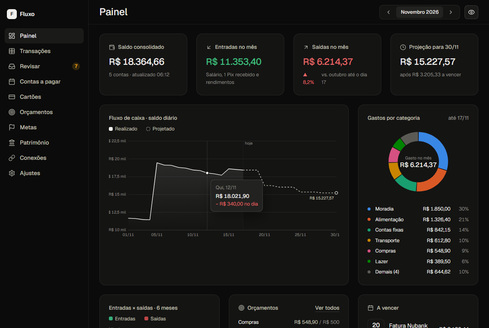
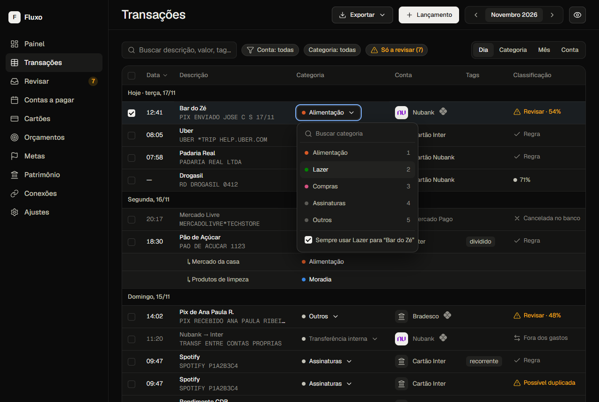
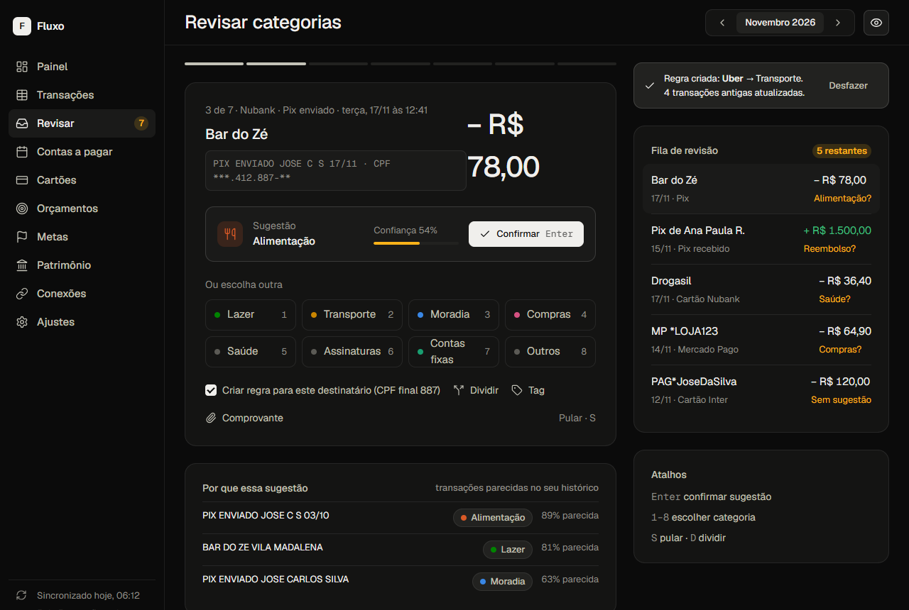
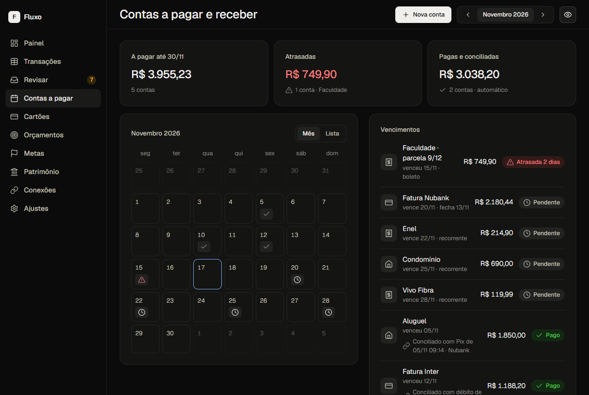
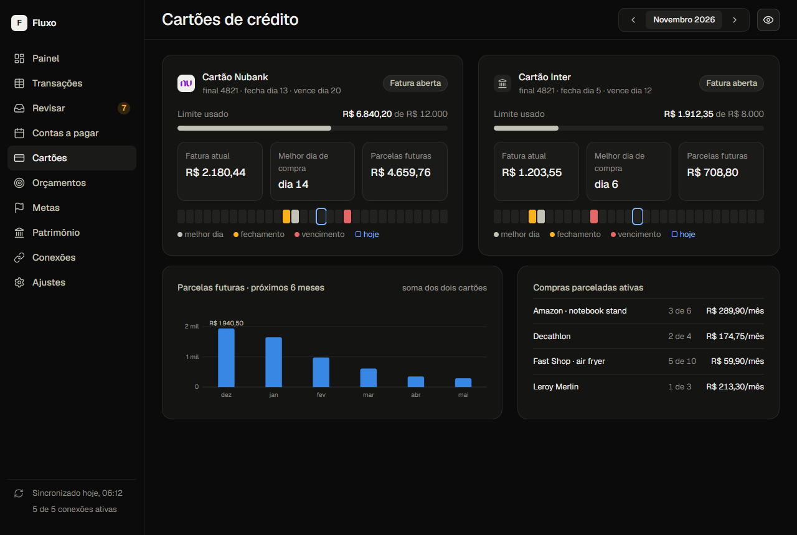
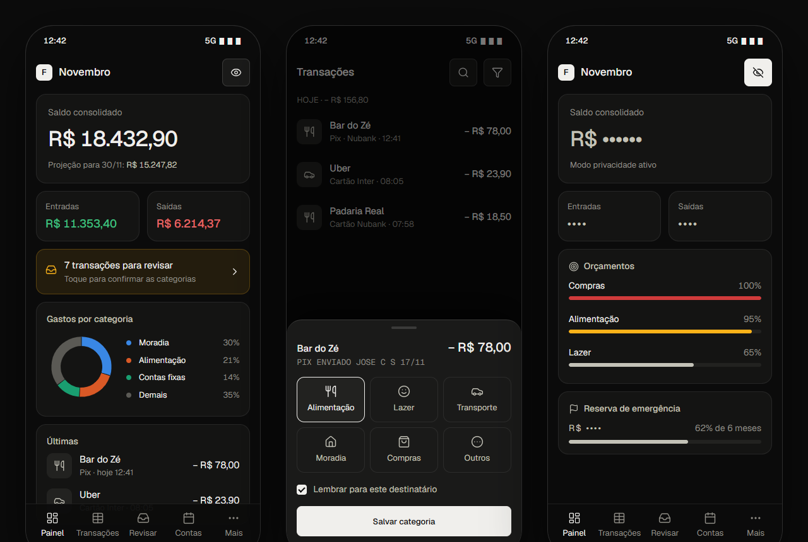

# Apogeu

Site pessoal de finanças conectado ao **Open Finance**: importa as transações dos bancos, categoriza sozinho, mostra para onde o dinheiro vai e o que ainda vai vencer. Funciona no navegador, no celular (PWA) e como app Android.

> **Ver o que ele faz:** abra a [vitrine com os protótipos](https://kauan1005.github.io/apogeu-app/). As telas abaixo são protótipos com **dados fictícios**.

## O que ele faz

- **Painel:** saldo consolidado, entradas e saídas do mês, fluxo de caixa diário com **projeção** até o fim do mês e gastos por categoria.
- **Transações:** todas as contas e cartões em uma tabela, com busca, filtros e agrupamento por dia, categoria, mês ou conta. Dá para dividir uma compra entre categorias.
- **Categorização que aprende:** regras e destinatários conhecidos primeiro, depois semelhança de texto; o que não tem certeza vai para a fila **Revisar**. Ao corrigir, o site sugere uma regra nova.
- **Contas a pagar e cartões:** vencimentos, faturas e o que está pendente, atrasado ou pago.
- **Orçamentos, metas e patrimônio**, e um modo de privacidade que esconde os valores.
- **Transferências entre contas próprias** e pagamento de fatura ficam fora dos gastos, para não contar duas vezes.

| Transações | Revisar |
|---|---|
|  |  |

| Contas a pagar | Cartões | Celular |
|---|---|---|
|  |  |  |

## Como é feito

| Parte | Tecnologia |
|---|---|
| Site | Next.js · TypeScript · Supabase (PostgreSQL, RLS) |
| Dados bancários | Open Finance (Meu Pluggy) |
| Hospedagem | Vercel, em planos gratuitos |
| App Android | Trusted Web Activity (casca do site, gerada com o Bubblewrap) |

## O que tem neste repositório

| Pasta | Conteúdo |
|---|---|
| [`design/`](design/) | Protótipos em HTML/CSS/JS (painel, transações, revisar, contas, cartões, celular, moodboard) |
| [`android/app/`](android/app/) | O app Android: código-fonte e configuração (`twa-manifest.json`) |
| [`docs/img/`](docs/img/) | Capturas dos protótipos usadas neste README |

O código do site em si fica em um repositório privado. Aqui estão só os protótipos e o app Android. O keystore de assinatura, senhas e chaves **nunca** entram no repositório.

## Rodar os protótipos

São páginas estáticas: baixe o repositório e abra `design/dashboard.html` no navegador. Ou use a [versão publicada](https://kauan1005.github.io/apogeu-app/design/dashboard.html).

## Compilar o app Android

Precisa de JDK 17 e do Android SDK. Em `android/app/`, crie um keystore seu e ajuste `signingKey` em `twa-manifest.json`, depois use `./gradlew bundleRelease`. O app abre o site `apogeu-financas.vercel.app`.
